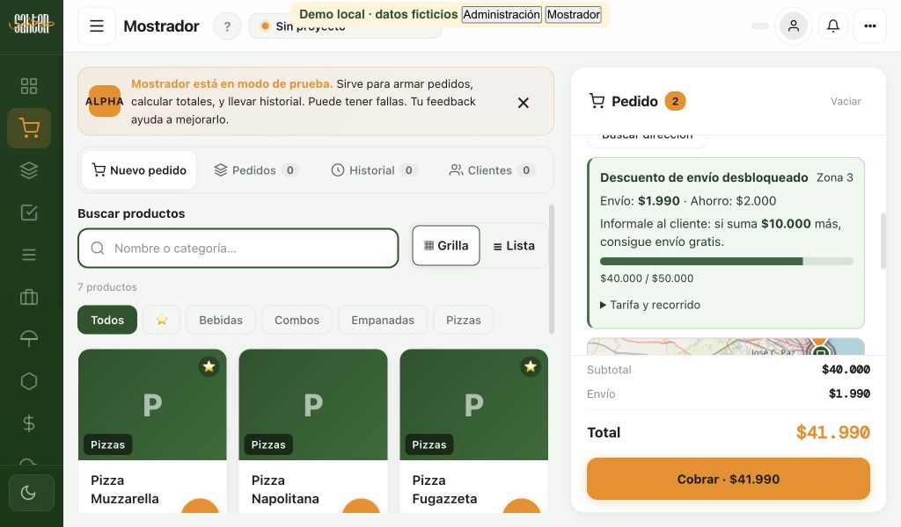
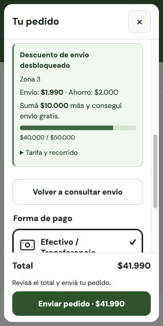
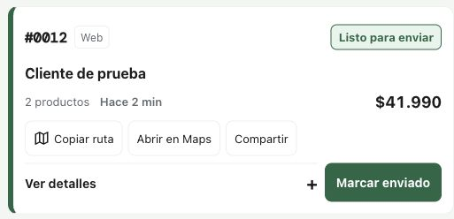

# Delivery geográfico, beneficios y horarios

Estado vigente al 28/10/2026: código integrado, migración aplicada, proveedor ORS conectado y funciones `sahten-delivery` v3 / `sahten-payments` v8 desplegadas. El dueño aprobó **activar la configuración local actual**, distinta del preset inicial: zonas 1–4 y beneficios activos; Zona 5 y Excepcional pausadas; Zona 1 ya no requiere autorización desde el 28/10/2026 (app 0.4.30 y control en vivo). Se guardó y sincronizó desde la app, sin SQL directo sobre menú/proyecto/pedidos. Ver [tabla vigente al pie](#configuración-local-activada--25102026). La auditoría general de UX continúa pausada. Las secciones de preparación siguientes documentan el proceso histórico, no sustituyen el estado vigente.

## 1. Módulos modificados

- `src/core/delivery.js`: motor compartido, ruta real, piso tarifario, mínimos, pausas, autorizaciones, horarios e históricos.
- `src/delivery/`: preset exclusivo de Sahten; geometría; editor Leaflet; conexión segura del proveedor; servicio, repositorio y cliente; tarjeta compartida web/POS.
- `src/project/schema.js`: preparación idempotente del preset al abrir/guardar el proyecto, conservando zonas y ventas anteriores. No cambia la versión del formato.
- Tienda online y Mostrador: búsqueda explícita de direcciones, barras de avance, invalidación de cotizaciones, validación del servidor antes de confirmar, autorizaciones y separación de retiro/delivery.
- Mercado Pago: valida la misma ruta y horario antes de reservar Checkout Pro. Sus notificaciones siguen procesando compras ya aceptadas aunque el local haya cerrado.
- Pedidos, historial, WhatsApp, comanda, reportes y CSV: conservan y muestran tarifa normal, tarifa cobrada, ahorro comercial, zonas, recorrido y revisión. El ahorro de envío no se duplica como gasto de repartidor.
- `supabase/migrations/20261024_delivery.sql` y función nueva `sahten-delivery`: preparados, **no aplicados**. También se necesita actualizar `sahten-payments`.

## 2. Preset inicial preparado (histórico; no es la tarifa vigente)

El centro coincide con la dirección publicada y con [OSM way 369183696](https://www.openstreetmap.org/way/369183696): **−34.5264314, −58.4818959**, General Julio Argentino Roca 1489, Vicente López. Consulta de geocodificación y verificación del 24/10/2026.

| Zona | Radio comercial | Tarifa | Beneficios de envío | Pedido mínimo neto |
|---|---|---:|---|---:|
| 1 | 0–2 km | $2.190 | Gratis desde $25.000 | $15.000 |
| 2 | >2–3,5 km | $2.990 | Gratis desde $35.000 | $15.000 |
| 3 | >3,5–5 km | $3.990 | $1.990 desde $35.000; gratis desde $50.000 | $15.000 |
| 4 | >5–6,5 km | $5.490 | $2.750 desde $55.000; gratis desde $80.000 | $30.000 |
| 5 | >6,5–8 km | $6.990 | $3.500 desde $80.000; sin envío gratis | $40.000 |
| Excepcional | >8–8,5 km | $9.000 | Autorización administrativa, sin beneficio automático | $15.000 |
| Fuera | >8,5 km | No disponible | No se puede autorizar superando el máximo | — |

Las zonas nuevas y sus promociones quedan **desactivadas inicialmente**. No se modifica el régimen publicado hasta su aprobación y activación. Los mínimos sugeridos de zonas 4/5 están cargados, editables; los demás conservan el mínimo conocido de $15.000.

La consulta de solo lectura del `menu.json` real el 24/10/2026 encontró zonas anteriores con tarifas $1.500/$2.500/$6.000 y umbral global gratuito $60.000. No se presenta $1.990 como tarifa anterior comprobada: esa referencia venía de la propuesta. Tampoco se anuncia públicamente la nueva tabla mientras siga preparada.

El preset solo se incorpora al proyecto identificado como Sahten por su slug o dirección coincidente. Otros negocios conservan su configuración y la app sigue arrancando vacía. El preset contiene datos públicos de ubicación, sin catálogo, clientes, contactos ni credenciales del negocio.

## 3. Dónde editar

**Ajustes → Negocio → Tienda online y delivery → Delivery geográfico e incentivos.** Solo dueño/admin puede modificarlo; el servidor verifica ese rol para claves y autorizaciones.

Se puede seleccionar cualquiera de los seis anillos en el mapa o por nombre; cambiar nombre/color, límites, tarifa, mínimo y beneficios; pausar una zona; exigir autorización; convertir un anillo en un polígono con hueco interior; mover, agregar o quitar vértices; dibujar un contorno nuevo; previsualizar; cancelar; revertir una zona o restablecer geometrías radiales. Las coordenadas también son editables con teclado. Convertir o editar una zona conserva sus tarifas y no cambia las demás.

Las superposiciones y polígonos inválidos bloquean el guardado. Los huecos requieren confirmación y quedan realmente sin cobertura. Restablecer geometrías conserva precios. Cambiar la ubicación exige volver a verificarla. Cada guardado genera una revisión nueva; la configuración viaja en el archivo y en la sincronización/publicación normales, sin claves privadas.

## 4. Cuenta única y controles operativos

1. Identificar una sola zona por su anillo o polígono; una zona pausada o ambigua no se confirma.
2. Consultar una ruta por calles en el servidor, vinculada al origen y destino exactos. El radio nunca se usa como recorrido de respaldo.
3. Aplicar el mayor piso tarifario que exija la ruta respecto de la zona geográfica. Se muestran ambas zonas cuando difieren.
4. Hasta 8 km reales: regular. Más de 8 hasta 8,5: autorización del dueño/admin, con responsable y motivo. Más de 8,5: rechazo incluso con autorización o polígono ampliado. Los máximos se pueden reducir.
5. Una excepción al piso tarifario requiere autorización explícita y registrada; no elimina mínimos, pausas, horario ni máximo operativo.
6. Calcular umbrales sobre **productos después del descuento comercial**, antes de sumar envío. El beneficio de pago del 10 % conserva su regla: solo productos y el mayor descuento de la orden, sin acumulación entre descuentos de productos.
7. Elegir el mejor beneficio de envío alcanzado. La combinación con el descuento por pago es una opción administrativa independiente. Queda preparada en “combinar”, conservando la posibilidad anterior; las promociones nuevas siguen apagadas hasta aprobación.
8. El backend recalcula productos, precios, cantidades, descuentos y envío. El catálogo público sincronizado del proyecto permite validar también productos internos de Mostrador que no se publican en la tienda. Cambios sin sincronizar deben sincronizarse antes de confirmar un delivery; no se acepta un importe local sin comprobar.

No se inventa disponibilidad de la moto, tiempo de entrega ni repartidor asignado. No se agregan horarios de corte anticipado ni pedidos programados.

### Horarios

Se preparó el horario confirmado y publicado, en **America/Argentina/Buenos_Aires**:

- Lunes a jueves: 18:00–22:00.
- Viernes y sábado: 18:00–23:00.
- Domingo: cerrado.

El inicio se incluye y el cierre se excluye: a las 22:00 de un jueves ya no se reciben nuevos deliveries. Web y app muestran el cierre y próxima apertura conocida; el servidor usa su propio reloj antes de aceptar efectivo, transferencia o reservar Mercado Pago. No confía en la hora suministrada por el comprador. La pantalla abierta se actualiza al cruzar el horario; retiro conserva su flujo.

El editor permite hasta cuatro turnos diarios y excepciones por fecha para feriados/cierres. Un turno que cruza medianoche continúa al día siguiente; una fecha especial cerrada interrumpe también esa continuación. Datos de horario inválidos bloquean el delivery. No se completaron feriados desconocidos. El horario de delivery estructurado se usa al publicar la sección de entregas; no reemplaza silenciosamente los horarios generales de atención/SEO del negocio.

### Autorizaciones y cambios de dirección

El cliente puede solicitar revisión de una entrega excepcional con nombre y teléfono. El dueño/admin la ve en **Mostrador → Pedidos**, con recorrido, dirección y motivo. La consulta y autorización vencen a los 15 minutos. El cliente debe volver a consultar el envío; se vuelve a comprobar ruta, revisión, horario y mínimo antes de confirmar.

Al cambiar la dirección se borran ubicación, tarifa, ruta y autorización anteriores. Una respuesta tardía de geocodificación o rutas no repone la dirección anterior. Las búsquedas se realizan mediante botón, no autocompletado contra el geocodificador público.

## 5. Tarjeta web y POS

Componente y fórmula compartidos. La **tarjeta de descuento tiene fondo verde claro, texto oscuro y barra verde**, en web y Mostrador. Los mensajes de restricción/cierre no se presentan como beneficios desbloqueados.

Para zona efectiva 3, subtotal neto $20.000: envío $3.990, faltan $15.000 para pagar $1.990, avance 57 %. A $40.000: envío $1.990, ahorro $2.000, faltan $10.000 para gratis, avance 80 %. A $50.000: gratis y barra completa, sin inventar un próximo objetivo. Zona 5 nunca anuncia envío gratis.

Se recalcula al agregar/quitar productos, elegir pago o cambiar destino. El POS adapta el texto al vendedor. No aparece en retiro. El cobro mantiene su lugar y la columna desplaza los detalles cuando la pantalla es baja. El componente respeta movimiento reducido; las etiquetas y el progreso son accesibles.

## 6. Evidencia y pruebas

Pruebas nuevas de motor, geometría, horarios, servidor, base de datos local, app real en jsdom y plantilla web generada. Incluyen toda la tabla comercial, mínimos, pausas, 8/8,5 km, autorización y roles, precio manipulado, reintentos, catálogo interno, 10 %, cambiar dirección, fallos del proveedor, persistencia de polígonos/horarios e históricos.

`tests/fixtures/delivery/routes-verified-2026-10-24.json` registra nueve destinos públicos, coordenadas, identificadores OSM, URL de consulta, distancia y fecha. Cubre las cinco zonas efectivas, una ruta excepcional de 8,4027 km y otra fuera de cobertura. Plaza Vicente López y Planes y Estación Olivos tienen radio menor de 2 km pero recorrido de 2,34/2,67 km: corresponde la tarifa efectiva 2. La búsqueda que devolvió “Estacion de Bombeo Los Álamos” se conserva con su etiqueta real; no se afirma que sea la estación ferroviaria Acassuso.

Las rutas de verificación son muestras puntuales del demo de OSRM, no una dependencia de producción ni garantía para motos. Los casos de frontera usan fixtures deterministas claramente identificados. Las pruebas PostgreSQL usan PGlite y Vault ficticio, sin conectarse a Supabase real.

Validación final: **582 pruebas en 61 archivos, todas aprobadas** (`npx vitest run`); compilación Vite/PWA, verificación de scripts clásicos y versiones 0.4.21, revisión de diferencias y comprobación Deno de ambas funciones correctas. `npm audit --omit=dev`: cero vulnerabilidades de producción. Deno avisa que ignora la opción heredada `allowJs` en pagos; no es un error de compilación. No se generaron instaladores ni se ejecutó una impresión física en esta tarea.

Chrome real: web a 320 × 640; Mostrador a 1366 × 768 y 1024 × 600, sin desbordamiento horizontal en esas vistas y con total/cobro visibles. Tarjeta con fondo calculado `rgb(237,247,238)` y texto `rgb(24,61,36)`, también en tema oscuro. Las capturas usan una demo local con productos/contacto ficticios y rutas registradas; los escenarios de beneficio desactivan el horario únicamente en esa demo para poder revisarlos de día. La captura de cierre simula todos los días cerrados; el preset real conserva el horario confirmado.

Las otras evidencias locales (1366, oscuro y cierre) están en `entregables/delivery-2026-10-24/` del espacio de trabajo del chat. No se probó una ruta real con openrouteservice ni un checkout productivo: falta la clave y el despliegue autorizado.

## 7. Proveedores, límites y privacidad

- **Leaflet + OpenStreetMap:** mapas y atribución visible. Se conserva el proveedor existente; no se contrata un mapa pago.
- **Nominatim público**, búsqueda explícita mediante servidor: [política oficial](https://operations.osmfoundation.org/policies/nominatim/), límite global de una consulta por segundo, caché breve, identificación de la app y país Argentina. No autocompletado. No usarlo para búsquedas masivas. Una instalación a mayor escala debe cambiar a un proveedor adecuado; el límite se coordina en la base, no solo por instancia.
- **openrouteservice Standard gratuito:** se necesita una clave de la cuenta del negocio, guardada en Vault desde la app. [Cuotas y limitaciones oficiales](https://giscience.github.io/openrouteservice/frequently-asked-questions), referencia Standard Directions de 2.000/día y 40/min; confirmar cuota vigente al crear la cuenta. [Uso comercial explicado por el proveedor](https://ask.openrouteservice.org/t/free-plan-in-an-app-with-a-paid-tier-license-cc-by-sa-4-0-personal-data-and-attribution-questions/8079). No se contrató un plan ni se creó una cuenta. El sitio del proveedor indicó mantenimiento al revisarlo; su documentación y portal de cuenta siguen siendo las referencias.
- Directions usa perfil `driving-car`, evita ferries, limita el punto de ajuste a 100 m y verifica extremos de la ruta. Es una estimación por calles sin tráfico, no un perfil específico de moto ni verificación de accesos privados. Los cambios de OSM pueden tardar en incorporarse.
- La clave solo la consulta el servidor; nunca aparece en `menu.json`, HTML, archivo del proyecto ni respuesta pública. La geocodificación y rutas transmiten la dirección/coordenadas necesarias a esos proveedores. Cachés limitadas; rate limits por tienda y origen. Las solicitudes de autorización pendientes son privadas; vencen a los 15 minutos y se depuran después de 30 días.
- [OSRM demo](https://project-osrm.org/docs/v26.4.0/http/) se consultó solo para muestras de desarrollo. No existe fallback automático al demo ni a una distancia inventada.

## 8. Pendiente antes de activar/publicar

1. Revisar y aprobar la rama/PR, tarifas, mínimos, combinación de beneficios y configuración horaria. Las promociones pueden seguir apagadas.
2. Actualizar/sincronizar primero el historial existente del proyecto, antes de activar la política nueva. Así queda la base histórica que las protecciones preservan.
3. Con autorización: aplicar la migración SQL; desplegar `sahten-delivery` y la actualización de `sahten-payments` **con verificación JWT desactivada en el gateway, como la función pública de pagos**. Ambas validan en el código las acciones que requieren sesión. Probar en un proyecto de ensayo antes del productivo.
4. Crear/consultar la clave Standard de openrouteservice desde su portal; el titular acepta términos/verificaciones. Guardarla desde **Servicio de rutas por calles**. No pegarla en el chat.
5. Verificar rutas reales con esa cuenta y cuotas, expiración de autorizaciones, pagos de prueba, sincronización de ventas POS, importación de órdenes y un cierre real de horario. Ninguna compra de prueba debe cobrar fondos reales.
6. Preparar instaladores actualizados y republicar la carpeta web nueva. Los clientes antiguos no conocen el nuevo protocolo: no activar la política antes de actualizar la tienda y los equipos que operan delivery.
7. Tras esa verificación y autorización, activar la configuración por el dueño/admin, guardar, sincronizar el proyecto y publicar/sincronizar menú. Comprobar que web y app usan la misma revisión. Si también se aprueban promociones, activar su casilla.
8. Verificar la tienda publicada y los reportes con una operación autorizada. No activar producción, cambiar tarifas o publicar desde esta revisión sin aprobación.

Los pedidos históricos conservan los importes originales. Cada nuevo delivery guarda revisión, zonas geográfica/efectiva, radio, recorrido, proveedor, tarifa base/cobrada/ahorro, validación horaria y autorización. Los reportes suman descuentos comerciales de envío por separado de gastos reales de reparto.

## Ruta lista para el repartidor — ampliación del 24/10/2026

En **Mostrador → Pedidos**, cada tarjeta de delivery aceptado ofrece, sin abrir detalles:

- **Copiar ruta** (icono de mapa): copia un enlace universal de Google Maps para pegarlo al repartidor.
- **Abrir en Maps**: abre ese destino directamente, también desde la app de escritorio.
- **Compartir**: abre el selector de aplicaciones del equipo; el usuario elige WhatsApp u otro destino. Si no está disponible, copia el enlace. Si el portapapeles no permite copiar, muestra un campo seleccionado de solo lectura.

En el flujo existente, la aceptación operativa corresponde a **En preparación**; los controles siguen en **Listo para enviar** y **En camino**. No aparecen en pendientes por aceptar, retiro, cancelados o completados. Copiar/compartir no marca enviado ni cambia pagos. La acción vuelve a comprobar el estado actual del pedido.

El enlace usa las coordenadas guardadas como destino y omite un origen fijo para que Maps use el GPS del repartidor. `dir_action=navigate` solicita navegación: según dispositivo, ubicación y permisos, Maps inicia la navegación o muestra su vista previa; puede requerir pulsar “Iniciar”. No se necesita buscar la dirección. Pedidos anteriores sin coordenadas utilizan la dirección escrita, con un aviso para revisar el punto. Si falta todo destino, no se inventa una ubicación ni se ofrece una ruta vacía.

El enlace y el mensaje de compartir no incluyen nombre, teléfono, importes, credenciales ni acceso al pedido. Solo el número identificador y el destino de reparto. La selección del destinatario y el envío los hace el operador; no se envían mensajes automáticamente ni se contrata otro servicio.

[Documentación oficial de Maps URLs](https://developers.google.com/maps/documentation/urls/get-started): enlaces universales sin clave API. Se usa `travelmode=driving`; no se promete un perfil de moto en todos los países. La ruta que elija Google no reemplaza ni recalcula la tarifa/recorrido ya validados para la compra. Este acceso sirve también con delivery anterior y no requiere activar la política v2 ni conectar una API de Google.

Pruebas: coordenadas exactas, dirección antigua codificada, destino ausente, estados permitidos, retiro/cancelación, portapapeles denegado, equipo sin compartir y cancelación voluntaria del selector; prueba con la app real verifica los controles en la tarjeta cerrada y que compartir no cambia el estado. No se envió información de un cliente real ni se contactó a un repartidor.

## Servidor aplicado con autorización — 24/10/2026

0.4.22 ya publicada y plantilla en Cloudflare `fa054caf-c8f5-4072-a5be-ecaad779dc0f`, con delivery v2 desactivado. El dueño autorizó iniciar sesión en OpenRouteService mediante GitHub y aplicar la migración/funciones en Supabase `dtnbokdrxojdcvguuidk`. Se aplicó la migración `delivery_geografico_y_rutas` y se desplegaron `sahten-delivery` v1 y `sahten-payments` v6. No se modificaron menús, proyectos, órdenes existentes ni tarifas comerciales.

Las tablas de `sahten_delivery_private` tienen RLS y el RPC privado permite solo service_role; anon/authenticated no reciben acceso de backend. El asesor detectó search_path modificable en dos funciones nuevas: se aplicó `20261025015321_delivery_function_search_paths.sql` y se comprobó su configuración fija. No se afirma que las advertencias preexistentes de otras funciones se hayan corregido.

El acceso GitHub llegó al alta HeiGIT; el titular debe terminarla. La cuenta todavía no aportó una clave, no hay proveedor configurado ni rutas reales verificadas mediante ORS. No activar las zonas nuevas ni anunciar sus promociones hasta guardar la conexión segura y completar la validación. Esta sección reemplaza los pendientes de autorización/despliegue anteriores, no los pendientes de verificación y activación.

## Conexión ORS verificada — 25/10/2026

El titular completó el alta y autorizó guardar su clave y consultar tres rutas. Clave guardada desde la app 0.4.22 en Vault; comprobada únicamente su existencia y fecha, sin leer secretos en SQL. Plan Standard oficial 0 €, 2.000 consultas diarias de Directions / 40 por minuto. [Planes oficiales](https://account.heigit.org/info/plans).

Se usa **api.heigit.org/openrouteservice/v2**. El [aviso oficial del cambio de dominio](https://ask.openrouteservice.org/t/deprecating-api-openrouteservice-org-in-favour-of-api-heigit-org/7912) anuncia cerrar la dirección anterior entre el 2 y el 6 de noviembre de 2026. La clave actual sirve para la URL nueva. La corrección de una sola URL se desplegó sobre la base 0.4.22: delivery v2 / payments v7. No se desplegaron los campos nuevos de impresión/efectivo del PR #26.

[Resultados de tres recorridos reales](delivery/rutas-ors-2026-10-25.json), desde el centro confirmado: Houssay 1,7074 km; Plaza Vicente López y Planes 2,5515 km; La Lucila 4,0622 km. La plaza tiene radio 1,9844 km: el recorrido confirma por qué corresponde considerar el piso tarifario de la zona 2. Los resultados son muestras puntuales, no tarifas activadas ni una garantía de tiempos/tráfico.

La prueba usa los mismos módulos del servidor en un diagnóstico local, con la clave solo en memoria y sin crear órdenes. Backend accesible y credencial cifrada verificados por separado. Falta probar una orden completa en ensayo, revisar las tarifas/horarios con el dueño, comprobar todas las cajas y recién entonces activar una revisión comercial. **La política publicada sigue apagada y los 36 productos permanecen iguales.** Esta sección reemplaza el pendiente de alta/clave de las secciones anteriores.

## Configuración local activada — 25/10/2026

El dueño pidió activar las reglas y confirmó explícitamente **«Activar la configuración local actual»** después de revisar sus importes y diferencias frente al preset. Se guardó con el editor normal, se validó sin huecos/superposiciones, se exportó una copia y se ejecutó **Nube y usuarios → Sincronizar menú**, confirmando tienda `sahten`, proyecto correcto y 36 productos. La app terminó con **Actualizando el menú de la web → Completado**. No se escribieron tablas públicas con SQL.

Revisión vigente: `2d0d93c3-5e24-4aeb-85f2-dc197876513f`, efectiva `2026-10-25T15:13:44.946Z`; active/promotionsEnabled/stackWithPayment = true. Centro, geometrías radiales, proveedor ORS, horario argentino y máximos de recorrido 8/8,5 km conservados. La política del catálogo público coincide íntegramente con la exportada de la app.

| Zona | Radio geográfico | Tarifa base | Mínimo neto | Beneficios | Estado |
|---|---|---:|---:|---|---|
| 1 | 0–2 km | $1.500 | $17.000 | Gratis desde $25.000 | Activa; sin autorización desde 28/10/2026 |
| 2 | >2–3,5 km | $3.000 | $25.000 | Gratis desde $35.000 | Activa |
| 3 | >3,5–5 km | $4.000 | $35.000 | $2.000 desde $42.000; gratis desde $50.000 | Activa |
| 4 | >5–6,5 km | $5.500 | $45.000 | $2.750 desde $62.000; gratis desde $80.000 | Activa |
| 5 | >6,5–8 km | $6.990 | $40.000 | $3.500 desde $80.000 (sin aplicar mientras esté pausada) | Pausada |
| Excepcional | >8–8,5 km | $9.000 | $15.000 | Sin beneficio | Pausada |

No se restauró la tabla original. El recorrido real puede imponer las condiciones de una zona superior; estas cifras no prometen cobertura por barrio. El 10 % de pago se aplica antes de calcular los umbrales de envío, solo a productos, con la regla ya aprobada de no acumular descuentos de productos y aplicar el mayor.

App 0.4.24 publicada y carpeta web actualizada en Cloudflare `b06a9f7d-f120-4ffa-a46d-c65666b39986`, éxito, `2026-10-25T15:22:34.673874Z`; catálogo y copia estática contienen la misma revisión activa. Se conservaron los 36 productos y sus precios.

Comprobación productiva del domingo: tienda muestra **Delivery fuera de horario · Volvemos el lunes 26-10, 18:00**; el endpoint quote devuelve 200 con quote.status=closed, la misma revisión y próxima apertura `2026-10-26T21:00:00Z`. No consultó una ruta ni creó una cotización persistida, pedido o pago. Retiro conserva su formulario y al quitar todo queda bloqueado continuar. La barra de incentivo en horario abierto está cubierta por las pruebas y la demo local; falta observar una operación operativa en horario real. No se alteró el reloj ni se desactivaron horarios para la comprobación productiva.

**Textos pospuestos:** FAQ y «Delivery y retiro» todavía anuncian el régimen anterior ($15.000 / gratis $45.000). Se mostró al dueño una propuesta de reemplazo y eligió **«Dejar los textos para después»**; no se modificaron esos textos en la app ni en la web. Pendiente explícito, separado de las reglas que sí están activas.

Tutorial del dueño: [guía visual](TUTORIAL-TIENDA.html) y [pasos escritos](GUIA-ACTUALIZAR-TIENDA.md). Evidencia del chat en `entregables/publicacion-0.4.24/` y `entregables/activacion-delivery-2026-10-25/`.

## Buscador de direcciones corregido — 25/10/2026

El geocodificador público falló desde el servidor (503 `routing_geocoder_unavailable`), aunque la consulta del mismo domicilio público desde este equipo devolvió el punto exacto. El texto web «sin conexión» era genérico y no demostraba una desconexión del cliente.

Se desplegó `sahten-delivery` v5: Pelias del proveedor ORS conectado, clave solo en servidor, caché por tienda/revisión y selección limitada a address/venue. Una localidad general no se presenta como una dirección precisa. Cuando no hay resultado preciso o el buscador falla, web y cliente de Mostrador 0.4.25 recurren a la búsqueda directa Nominatim ya existente, después de pasar los límites del servidor. No se saltean cuotas ni se usa un respaldo de rutas. El servidor sigue siendo la autoridad sobre recorrido, tarifa, horario y autorización.

Web corregida en Cloudflare `0eabc917-487c-4e13-973e-c538d0bd88a8`. Chrome devuelve la dirección pública exacta del local; no se confirmó una compra. 602 pruebas aprobadas en 63 archivos, sin omitir casos. Política, importes y horas activadas permanecen iguales. La actualización de app que incorpora el respaldo requiere instalar 0.4.25 cuando termine su publicación.

Referencias oficiales: [cambio de URL de Pelias/ORS](https://ask.openrouteservice.org/t/deprecating-api-openrouteservice-org-in-favour-of-api-heigit-org/7912), [política de Nominatim](https://operations.osmfoundation.org/policies/nominatim/). Se mantiene búsqueda explícita, caché y límite global; no se añadió autocompletado ni proveedor pago. La disponibilidad y cobertura de los servicios públicos no constituyen un SLA comercial.

## Sugerencias automáticas — ampliación antes de publicar 0.4.25

Por solicitud posterior del dueño, web y Mostrador sugieren al escribir calle y altura después de 350 ms. Comparten Georef oficial para direcciones argentinas; la caché es de memoria (5 minutos para consultas, contexto de municipios/departamentos por centro), no persistente. Se cancelan solicitudes anteriores y no se aceptan resultados tardíos de otra dirección/proyecto. Solo se proponen filas con altura y coordenadas, priorizando coincidencia de calle y cercanía; la localidad opcional reduce ambigüedad. El punto de Georef es estimado: el cliente selecciona la opción y el servidor vuelve a validar el reparto antes de aceptar una compra.

Se elimina el botón manual de la vista habitual. «Buscar de otra forma» aparece solo si falla la consulta o no hay resultados; Nominatim sigue reservado a esa búsqueda explícita. El motor de sugerencias no requiere credenciales, no envía nombre/teléfono y no modifica límites, horas, zonas, tarifas ni históricos. Ver [documentación oficial de Georef](https://www.argentina.gob.ar/georef/normalizacion-de-direcciones). Cobertura automática argentina; si no hay ubicación válida, se invita a incluir localidad o usar la búsqueda explícita.

Chrome real: «Roca 1489» en la tienda de revisión y «Corrientes 1234» en Mostrador con una pizzería ficticia, sin confirmar pedidos. Función técnica: 543 ms inicial / 0 ms repetida; interfaz web alrededor de 1 segundo incluyendo pausa de 350 ms. Son mediciones puntuales, no un SLA. Evidencia en `entregables/publicacion-0.4.25/`.

Publicación automática y formulario simplificado verificados en producción: Cloudflare `c20f3cd9-f0f0-4547-bbef-7264321d509b` (25/10/2026, éxito). Los 17 archivos coinciden por hash y cuatro fotos responden 200. Chrome productivo muestra sugerencias de «Roca 1489» sin botón; Mostrador de ejemplo aislado muestra «Corrientes 1234», también sin botón. No se crearon órdenes ni pagos. 608 pruebas / 64 archivos y CI del PR #29 aprobados.

Instaladores [0.4.25](https://github.com/danielcamposlozada/sahten/releases/tag/v0.4.25) publicados y actualizador verificado: Windows EXE/MSI, Mac universal, siete entradas con firmas de actualización presentes y enlaces 200. Proceso Release `40228407580` correcto. Para recuperar estas sugerencias en la app instalada, actualizar a 0.4.25.
